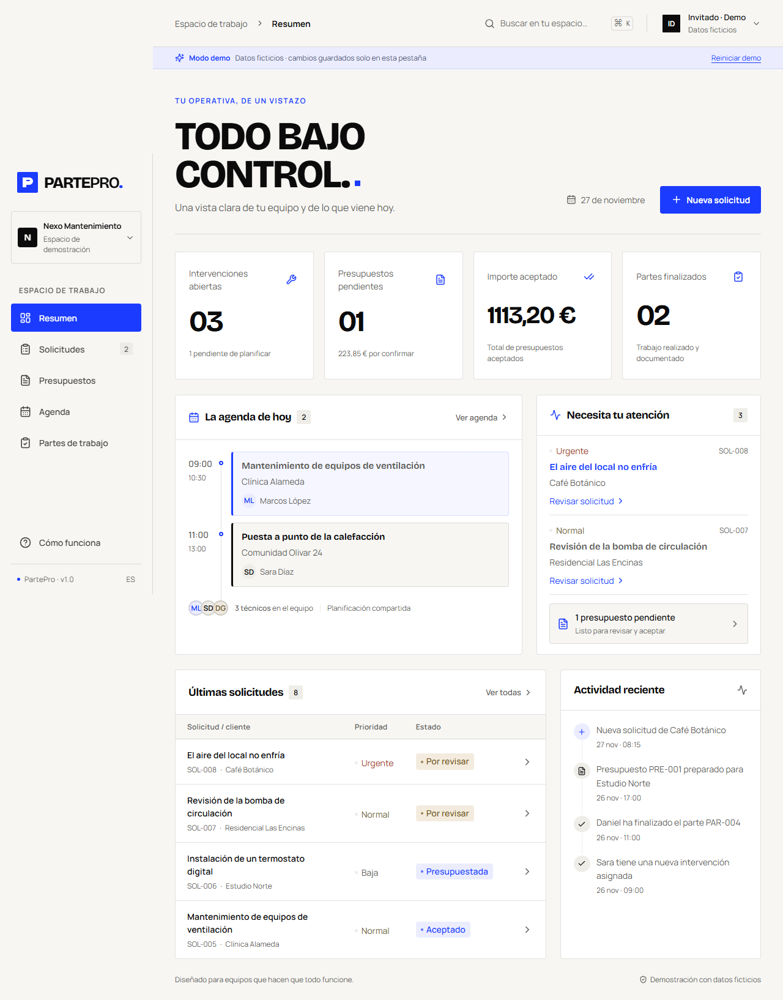

# PartePro

Gestión de mantenimiento para equipos que trabajan dentro y fuera de la oficina. Una solicitud se convierte en presupuesto, intervención planificada y parte de trabajo, con un historial de actividad y permisos por empresa.

**Stack:** Next.js 16.4.6 · React 19 · TypeScript estricto · Supabase Auth/Postgres · Zod · Vitest · Playwright.

**App pública:** [partepro-three.vercel.app](https://partepro-three.vercel.app). Producción en Vercel Hobby y Supabase Free, sin login de Vercel. La pantalla de entrada permite iniciar sesión con la cuenta privada de evaluación y probar la persistencia real en Supabase. **Explorar demo** es una opción secundaria, explícita y aislada por pestaña.



[Verificación en GitHub Actions](https://github.com/Chemi90/partepro/actions/workflows/verify.yml): pruebas de aplicación y aislamiento en una instancia Supabase efímera.

## Probar la aplicación

Requiere Node.js 22 o 24 y npm.

```bash
npm ci --ignore-scripts
npm run dev
```

Abrir http://127.0.0.1:3000. Iniciar sesión con las credenciales de evaluación para trabajar con Supabase, o elegir **Explorar demo**: esa opción funciona sin cuentas ni claves y guarda únicamente datos ficticios en la pestaña. El indicador de modo distingue la demo del acceso conectado. Reiniciar la demo no borra datos remotos. Cerrar una sesión real devuelve a la pantalla de acceso.

Recorrido sugerido (2 minutos):

1. En Solicitudes, abrir **El aire del local no enfría** o crear una solicitud.
2. Preparar un presupuesto con conceptos del catálogo. Los importes e impuestos se calculan automáticamente.
3. Aceptarlo para crear una intervención pendiente.
4. Planificarla para un técnico sin solapar otra cita.
5. Cerrar el parte con un informe y materiales. Consultar el resultado en Resumen y Partes.

## Supabase local: persistencia y permisos reales

Requiere Docker. La configuración no permite registro público ni usuarios anónimos.

```bash
npx --yes supabase@3.4.0 start
node tests/support/loopback-local-stack.mjs
node scripts/local-env.mjs
npm run db:seed
npm run dev
```

El script de loopback limita API y Postgres a 127.0.0.1, conservando los volúmenes del proyecto. El seeder es aditivo, solo usa datos ficticios y deja las credenciales en `.local/demo-access.json`, excluido de Git. Introducirlas en **Iniciar sesión**, en la pantalla de entrada. No compartir credenciales administrativas de Supabase.

Para aplicar migraciones nuevas al entorno local:

```bash
npx --yes supabase@3.4.0 migration up --local
```

## Arquitectura

```text
Navegador
  ├─ Demo: estado ficticio por pestaña, sin escrituras remotas
  └─ Sesión real → API Next.js → usuario verificado → membresía
                                    ↓
                     Supabase: JWT del usuario + RLS
                                    ↓
                   RPC transaccionales con reglas de negocio
```

Tablas normalizadas: organizations, memberships, customers, technicians, catalog, requests, quotes, quote_items, jobs, job_materials y activities. Los roles anon/authenticated no pueden escribir directamente; service_role queda reservado a la administración. Las claves foráneas compuestas impiden relacionar registros de empresas diferentes.

La API recalcula/valida mediante RPC. La base de datos vuelve a comprobar identidad, rol, empresa, campos, precios, estados y agenda aunque se llame directamente a Supabase. El técnico solo recibe trabajos asignados y sus datos asociados.

## Equipo de agentes

- [Orquestador](AGENTS.md): alcance, arquitectura, delegación, integración y entrega.
- [Develop](agents/develop/DEVELOP.md): implementación y correcciones.
- [Testing](agents/testing/DIRECTRICES.md): criterios previos y revisión independiente.

La configuración reproducible está en `.codex/config.toml` y `.codex/agents/`. Abrir este repositorio en Codex y solicitar al Orquestador una tarea: debe delegar en Develop, pedir revisión a Testing y devolver los fallos hasta superar los criterios. El proyecto no necesita una API de IA en producción: los agentes trabajan durante el desarrollo.

Ver [registro del equipo](docs/agent-log.md) y [resultados de Testing](docs/testing.md). Los informes distinguen pruebas ejecutadas y pendientes; no son transcripciones inventadas.

## Comprobaciones

```bash
npm run typecheck
npm test
npm run build
npm run test:e2e
node --env-file=.env.local tests/database/security.mjs
npm audit --audit-level=high
```

Las pruebas de base de datos solo admiten la instancia local específica y crean/limpian sus propios usuarios y empresas. No apuntarlas a producción. La CI ejecuta pruebas de aplicación y Supabase en trabajos separados, sin secretos de producción. Las pruebas E2E conectadas se ejecutan cuando existen las credenciales locales; consultar el informe para su cobertura.

## Integraciones

La exportación `.ics` funciona sin servicios externos. La sincronización con Google Calendar está implementada para un calendario dedicado, mediante una cuenta de servicio con permiso sobre ese calendario. Configurar las variables de `.env.example` y `CALENDAR_ORGANIZATION_ID`. El ID estable del evento evita duplicados y las llamadas no envían invitaciones.

No confundir exportación con sincronización: si el proveedor no está configurado la app lo indica. No se afirma haber validado la integración con Google hasta conectarla y comprobar el evento real.

## Entrega y seguridad

Consultar [despliegue](docs/deployment.md), [seguridad](SECURITY.md) y [guion de entrega](docs/submission.md). No subir `.env.local`, `.local/`, tokens, contraseñas o claves de servicio. La aplicación no garantiza invulnerabilidad y debe mantenerse actualizada.

## Referencia de diseño

La interfaz sigue el lenguaje visual de [Speed Paradigm](https://www.speedparadigm.com/): fondo papel, negro, azul intenso, tipografía Bricolage Grotesque/Manrope y controles de bordes definidos. La adaptación conserva la marca PartePro y su navegación de gestión. Las fuentes se sirven localmente con sus licencias SIL OFL. Las decisiones y tokens se documentan en [diseño](docs/design.md).
